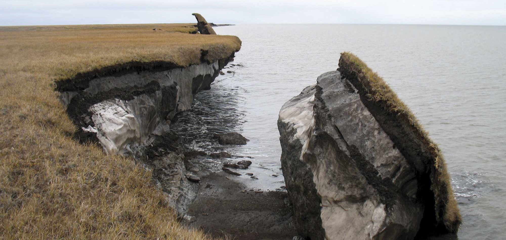
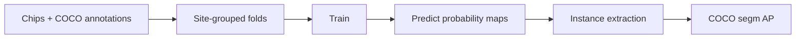

# arctic-rts-scaffold



PyTorch scaffold for retrogressive thaw slump (RTS) instance segmentation on multi-band Arctic satellite chips, with site-grouped cross-validation and COCO segmentation AP evaluation.

## Task

Retrogressive thaw slumps are landslide-like landforms that form when ice-rich permafrost thaws and collapses. The [2026 GeoAI Arctic Challenge](https://cyber2a.github.io/challenge/) asks for one mask per RTS instance on eight-band image chips (optical, spectral and ArcticDEM-derived layers). Training labels use COCO instance segmentation format; scoring is COCO segmentation AP on a hidden test set.

This repository holds the project structure and a runnable loop built on a placeholder model. The solution submitted to the challenge is withheld until the challenge ends.

## Pipeline



| Stage | Module | Contract |
|---|---|---|
| Load | `src/rts/data.py` | `.npz` chips (`image`, H x W x C) and COCO RLE masks; per-channel statistics from training chips only |
| Folds | `src/rts/folds.py` | `site_folds(image_ids, sites, n_folds, seed)` returns `(train_ids, val_ids)` pairs; a site never appears on both sides |
| Model | `src/rts/model.py` | Name-to-constructor registry; `stub` is a two-layer conv net |
| Train | `src/rts/train.py` | `run_fold(cfg, train_ids, val_ids)` trains, predicts the validation chips and scores them |
| Instances | `src/rts/postprocess.py` | Probability map to COCO result dicts via connected components |
| Evaluate | `src/rts/evaluate.py` | `pycocotools` segmentation AP over a subset of images |

## Layout

```
configs/default.toml     run configuration
src/rts/                 package (config, data, folds, model, train, postprocess, evaluate, synthetic, cli)
tests/                   pytest suite for folds, data, instances, evaluation and one training fold
assets/header.jpg        header image (see Credits)
Makefile                 setup, test, smoke
```

## Run

Requires Python 3.11+ and [uv](https://docs.astral.sh/uv/).

```bash
make setup    # uv sync
make test     # pytest
make smoke    # synthetic chips -> site folds -> train fold 0 -> COCO AP
```

`make smoke` prints one JSON object with `AP`, `AP50`, `AP75`, `APs`, `APm`, `APl`. The chips are random blobs and the model is the stub, so the values show that the stages connect, not model quality.

Other commands:

```bash
uv run rts synth                 # write synthetic chips under data_root
uv run rts folds                 # fold sizes for the data under data_root
uv run rts train --fold 0        # train and score one fold
uv run rts --config my.toml ...  # custom configuration
```

`RTS_DATA` and `RTS_OUT` override `data_root` and `out_dir`. The loader expects `annotations.json` plus the chip files that it references under `data_root`, with a `site` string on each image entry for the fold split.

## Status

The scaffold is the public part of the project. Models, training recipe, post-processing and results for the challenge stay private until the challenge closes.

## Credits

Header image: "Climate Impacts to Arctic Coasts", a collapsed block of ice-rich permafrost at Drew Point, Alaska. Photo by Benjamin Jones, U.S. Geological Survey. Public domain (U.S. federal government work, `PD-USGov-USGS`). Cropped from the original.
Source: https://www.flickr.com/photos/usgeologicalsurvey/32682616471/ · Commons file page: https://commons.wikimedia.org/wiki/File:Climate_Impacts_to_Arctic_Coasts_(32682616471).jpg

Challenge: 2026 GeoAI Arctic Challenge, https://cyber2a.github.io/challenge/. The dataset builds on Yang et al. (2023), *Remote Sensing of Environment*.
